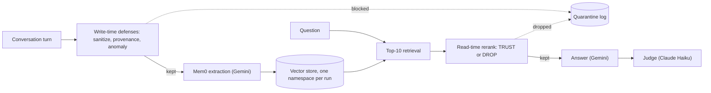

# The Price of Safety

[](https://arxiv.org/abs/2609.22818)
[](https://github.com/pritom02bh/memdefense/releases/tag/v3.0)
[](LICENSE)
[](LICENSE-DATA.md)

Benign-case utility and token overhead of memory-poisoning defenses in LLM agents.

Pritom Bhowmik, pritombhowmik@ieee.org

Memory-poisoning defenses are usually judged by the attacks they stop. This repository measures what they cost when there is no attack: four defenses wrap a Mem0 agent on benign LoCoMo conversations, and every model call is metered.

Main findings (v3):

- No defense shows a detectable accuracy cost on core questions. The -4.4 point reranker cost reported in arXiv v2 came from a model-routing confound, fixed here.
- Defenses still pay a benign-case price: 1.5 to 4.5% extra tokens for the LLM-based defenses, and false quarantines that depend on the backing model. The anomaly check flags 3 benign turns on Gemini and none on gpt-4o-mini. The reranker drops 2.2% of the memories it judges, and about half of the audited drops removed relevant evidence.
- Several pipeline effects can each produce a plausible but wrong result: model routing, the date Mem0 writes into its prompts, hosted-model drift, and near-deterministic extraction. The harness checks for all of them.

## How it works



Every model call goes through a LiteLLM proxy that logs the model that served it, its purpose (base, defense or judge), its step and its run. Each run writes to its own memory namespace, so runs cannot affect each other. No attack is run: every condition sees the same benign conversations, so every quarantine is a false alarm, and accuracy is compared against an undefended baseline on the same questions.

Design: 6 conditions (none, sanitize, provenance, anomaly, rerank, stacked) x 5 LoCoMo conversations x 3 replicates = 90 runs, plus a 45-run model-swap split (30 v2 runs and 15 baseline-mini runs) described below.

## Results (v3, corrected)

| Defense    | Stage | Core accuracy change, pp [95% CI] | Token overhead tau | FQR                          |
|------------|-------|-----------------------------------|--------------------|------------------------------|
| sanitize   | write | +0.69 [-1.74, +3.11]              | 0.00%              | 0.00% (0 / 2250 turns)       |
| provenance | write | +0.77 [-2.71, +4.24]              | 0.00%              | 0.00% (0 / 2250 turns)       |
| anomaly    | write | +4.69 [+0.42, +9.15]              | 1.47%              | 0.40% (9 / 2250 turns)       |
| rerank     | read  | +0.61 [-2.63, +3.78]              | 2.99%              | 2.21% (169 / 7650 memories)  |
| stacked    | both  | +4.69 [+0.14, +9.36]              | 4.46%              | 0.40% write, 1.32% read      |

- **Pairing.** Each change is paired against the undefended baseline on the same 200 core questions: majority vote over the three replicates, conversations weighted equally, stratified bootstrap CI with 10,000 resamples.
- **Anomaly and stacked.** The bootstrap interval excludes zero, but exact McNemar (p = 0.15 and 0.17) and the per-conversation sign-flip test (p = 0.125, floor 0.0625 at five conversations) do not reject. Anomaly blocked one turn in each of conv-26, conv-30 and conv-41. Because extraction is near-deterministic, every memory extracted after that turn differs from the baseline's, so these deltas compare different stores rather than isolating the blocked content.
- **Definitions.** Tau is defense tokens over baseline tokens (store extraction plus answers of the none cells). FQR is quarantines per decision.
- **Audit.** A blind audit of 50 rerank drops judged 2 justified, 26 relevant to the gold answer and 22 irrelevant.
- **Build periods.** conv-26, conv-30 and conv-41 answer from memory built in October 2026, conv-42 and conv-43 from memory built in August 2026. Every paired comparison is within one conversation, so it never mixes the two.

Source: `results_v3/stage6_final_report.txt` in the data release, which also has the per-period and per-conversation tables.

## Correction to arXiv v2

In v2, the rerank and stacked conditions generated their answers with gpt-4o-mini, and their anomaly and rerank verdicts also ran on gpt-4o-mini, while the baseline and the other conditions answered with the Gemini backbone. The reported rerank cost (-4.43 pp) therefore mixed a defense effect with a model swap.

v3 runs every defense call and every answer on the cell's backbone. With that fixed, the reranker shows no detectable accuracy cost (+0.61 pp, CI [-2.63, +3.78]).

A model-swap split on the v2 runs separates the two parts: v2's -4.43 pp decomposes into -2.93 pp (CI [-6.92, +0.83]) from answering with gpt-4o-mini instead of Gemini (baseline-mini minus v2 none) and -1.50 pp from the reranker at equal model (v2 rerank minus baseline-mini, CI [-4.98, +2.04]).

## Setup

- Agent backbone (extraction, answers, anomaly and rerank verdicts): gemini-3.1-flash-lite
- Embedding: text-embedding-3-small
- Judge: claude-haiku-4-5-20251001 (cross-provider; prompt frozen in prompts/judge.txt)
- Memory: Mem0 2.0.15 with local Qdrant, one namespace per run, top-10 retrieval, temperature 0, extraction max_tokens 4000
- Data: LoCoMo conv-26, 30, 41, 42, 43, first 150 turns; questions whose evidence survives the truncation, at most 75 per conversation (200 core, 55 adversarial)
- Scoring: core answers by the judge; adversarial answers by abstention, with hand labels overriding the detector

Defenses:

- sanitize (write): regexes for injection phrasing on each raw turn; no model call
- provenance (write): blocks turns that did not come from a conversation participant; LoCoMo has no other origin, so it never fires
- anomaly (write): one backbone call per turn, BENIGN or SUSPICIOUS
- rerank (read): one backbone call per retrieved memory, TRUST or DROP
- stacked: all four, each wrapping the next

A defense call that fails is retried and, if it still fails, aborts the run. It never defaults to allow.

## Reproduce

### 1. Install

Requires Python 3.11.

```bash
git clone https://github.com/pritom02bh/memdefense.git && cd memdefense
python3.11 -m venv .venv && source .venv/bin/activate
pip install -r requirements.lock
python3 -m unittest discover -s tests -t .
```

Place LoCoMo (locomo10.json from snap-research/locomo) at data/locomo/locomo10.json, sha256 79fa87e90f04081343b8c8debecb80a9a6842b76a7aa537dc9fdf651ea698ff4.

### 2. Check the released results (no API keys needed)

Download results_v2.tar.gz and results_v3.tar.gz from the [data release](https://github.com/pritom02bh/memdefense/releases/tag/v3.0) and unpack them in the repository root (they create results/ and results_v3/). Then:

```bash
export MEMDEF_RESULTS=results_v3
python3 -m scripts.check_integrity          # every manifest cell against the proxy log
python3 -m scripts.stats --json             # paired statistics from the manifest
python3 -m scripts.stage6_report            # the full results report
```

results_v3/final_cells.json is the manifest: the one cell per condition, conversation and replicate that the paper uses, plus the split cells. Every analysis script reads its cells from it, and the integrity check must pass before any statistic is computed.

### 3. Regenerate cells (API calls)

Requires OpenAI, Anthropic and Google API keys. All paths come from one results root, set with MEMDEF_RESULTS (default results/). Start the proxy with the same value so its log lands in the root it serves.

```bash
printf 'OPENAI_API_KEY=...\nANTHROPIC_API_KEY=...\nGOOGLE_API_KEY=...\n' > .env

# terminal 1: metering proxy
set -a; source .env; set +a
MEMDEF_RESULTS=results_v3 litellm --config proxy/config.yaml --port 4000

# terminal 2
export MEMDEF_RESULTS=results_v3
export MEMDEF_PROMPT_DATE=2026-10-30        # date Mem0 writes into extraction prompts
python3 -m runner.v3 --protocol             # results_v3/PROTOCOL.md
python3 -m runner.v3 --manifest             # results_v3/final_cells.json
python3 -m runner.v3 --dry-run              # calls and cost still to make
python3 -m runner.v3 --smoke                # one call of each type
python3 -m runner.v3 --run                  # or scripts/run_v3.sh, unattended
```

runner.v3 plans its cells from the v2 cells in results/ and answers some of them from the v2 Mem0 stores. The stores are not in the data release because of their size, so a rerun from the release rebuilds stores, and hosted-model drift means it will not reproduce the exact numbers. That is why the outputs are released. results_v3/PROTOCOL.md records every batch, model, budget and known deviation.

## Repository layout

- adapters/, defenses/, core/: the Mem0 adapter, the defense wrappers, retries, call tagging, the judge, labels, the results root
- proxy/: LiteLLM configuration and the metering logger
- runner/run.py: the v2 runner; runner/v3.py: the v3 regeneration (re-ingest, answer, manifest, protocol)
- scripts/: integrity check, statistics, Stage 4 and Stage 6 reports, labeling sheets and import, figures
- scripts/diagnostics/: one-off analyses whose reports are in the data release (Gemini change, prompt date, reproducibility tests)
- paper/auto/: figures from arXiv v2, superseded by v3
- versions.md: setup notes from v1, kept for history
- tests/: offline tests, no API calls

## Pipeline pitfalls

<details>
<summary>Seven effects that produced a plausible result, or nearly did (click to expand)</summary>

- **Model routing.** Defense verdicts and the reranker's answers used the proxy's default alias (gpt-4o-mini) instead of the cell's backbone, which produced the v2 rerank result. Every model call now takes the cell's backbone, a live guard checks each logged call against the allowed model for its step, and the integrity check repeats it.
- **Mem0's date in the extraction prompt.** Mem0 2.0.15 writes the UTC date of each call into every extraction prompt as Observation Date and Current Date. Stores built on different UTC dates diverge from the first turns; builds on the same date largely agree. MEMDEF_PROMPT_DATE pins the date, and every October store was built with 2026-10-30.
- **Hosted-model drift.** Even with the August prompt date pinned, an October rebuild of an August store matched it on only 17 of 150 turns (207 against 247 memories). Each conversation therefore answers from memory built in one period only.
- **Near-deterministic extraction.** In October, stores of the same conversation built on the same date are nearly identical, and none s2 and s3 give identical answers on 96 to 100% of questions. The three replicates of an October conversation are not independent draws; August replicates agree on about half.
- **Fail-open defaults and lost calls.** Earlier code read a failed defense call as BENIGN or TRUST, counted a failed extraction as an error and moved on, and let Mem0 drop unparseable extractions silently. Every call is now retried, and a call that still fails aborts the run.
- **Uncounted retries.** The OpenAI SDK and the LiteLLM router each retried on their own, below the project's retry counter. In one run the proxy retried a request the client had already abandoned, 79 minutes later, leaving one extra logged verdict. Both now have retries disabled, and every retry is counted per step.
- **Silent extraction loss.** A larger Gemini reasoning model stored 82 and 67 memories on conv-26 and conv-30, against 309 and 282 for the final backbone, and no error was raised. Only 4 of its 300 extraction calls reached Mem0's default output limit, so most of the gap came from the model change or from output Mem0 discarded. Extraction now runs with max_tokens 4000, and an extraction that cannot be parsed is retried instead of stored as no facts.

</details>

## Limitations

Five conversations and three replicates give about plus or minus 4 points of resolution, and the October replicates are close to identical. One backbone, one memory framework, one judge. No attack is run, and no act-time defense is tested.

## Citation

```bibtex
@misc{bhowmik2026priceofsafety,
  title         = {The Price of Safety: Benign-Case Utility and Token Overhead of Memory-Poisoning Defenses in LLM Agents},
  author        = {Bhowmik, Pritom},
  year          = {2026},
  eprint        = {2609.22818},
  archivePrefix = {arXiv},
  primaryClass  = {cs.CR}
}
```

If you use the data release, please also cite LoCoMo:

```bibtex
@inproceedings{maharana2024locomo,
  title     = {Evaluating Very Long-Term Conversational Memory of LLM Agents},
  author    = {Maharana, Adyasha and Lee, Dong-Ho and Tulyakov, Sergey and Bansal, Mohit and Barbieri, Francesco and Fang, Yuwei},
  booktitle = {Proceedings of the 62nd Annual Meeting of the Association for Computational Linguistics},
  year      = {2024}
}
```

## License

- Code: MIT. See [LICENSE](LICENSE).
- Data release: the archives contain text derived from LoCoMo, which is licensed CC BY-NC 4.0, so they are released under the same license. See [LICENSE-DATA.md](LICENSE-DATA.md).
